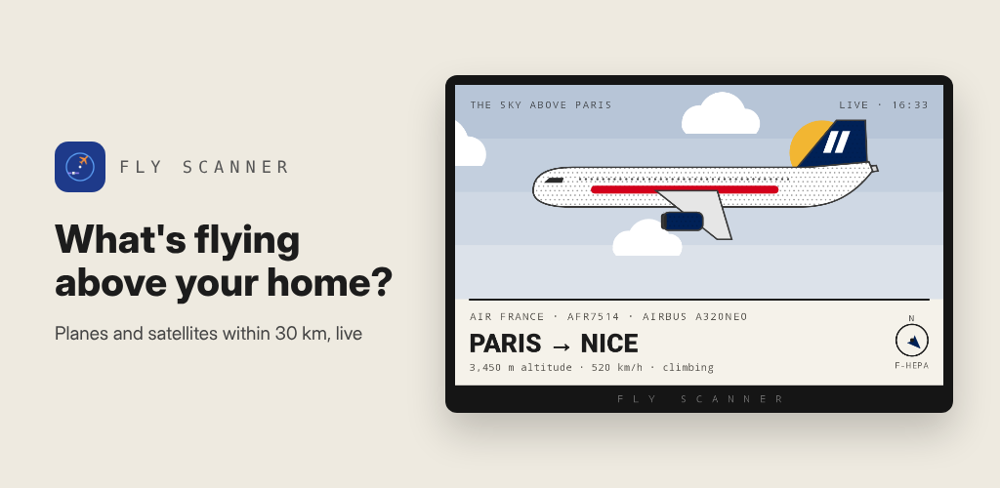
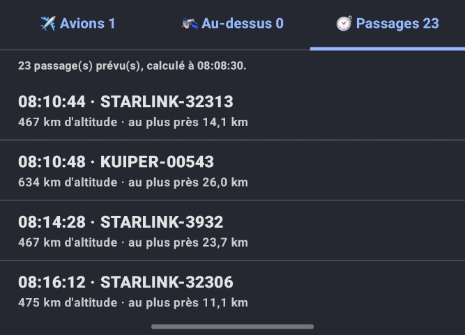

# BortoSoft

**Simple software to make everyday life easier.**

BortoSoft is a small collection of apps built to solve real, everyday problems — no clutter, no complicated setup. Just open the app and it works.

| App | What it does |
|---|---|
| 🧾 [Warranty Manager](#-warranty-manager) | Keeps all your product warranties in one place, so you never lose a receipt again. |
| ✈️ [Fly Scanner](#️-fly-scanner) | Shows you the planes and satellites flying above your head, right now. |

---

## 🧾 Warranty Manager

### The problem
You buy a TV, a phone or a coffee machine. Two years later it breaks… and the receipt is lost, faded, or buried in a drawer. Is it still under warranty? Nobody knows.

### The solution
Warranty Manager stores your receipts and warranty dates on your phone and tells you at a glance what is still covered.

  

<table>
  <tr>
    <td align="center" width="50%">
      
       <b>Planes above you</b> – route, altitude and distance
    </td>
    <td align="center" width="50%">
      
       <b>Satellite passes</b> – time, altitude and closest distance
    </td>
  </tr>
</table>

### How it works
1. **Take a photo** of your receipt.
2. **The app reads it for you** and fills in the product, price, store and purchase date.
3. **Done.** Your product is saved with its warranty end date — you can add a note if you like.

### Features
- 📷 Scan a receipt with your camera
- 🔍 Automatic text recognition (no typing needed)
- 📅 See which warranties are still valid and which have expired
- 🏬 Keep the product, price, store and a personal note together
- 🔒 Your data stays on your phone

---

## ✈️ Fly Scanner Android App

### The idea
Ever looked up at the sky and wondered *"Where is that plane going?"* or *"Is that a satellite?"* Fly Scanner gives you the answer.

### What it does
Fly Scanner shows you the **airliners** and **satellites** that are passing over your location, in real time.

  
  &nbsp;&nbsp;

  &nbsp;&nbsp;
  

### How it works
1. **Open the app** — it uses your location.
2. **See what's above you** — planes and satellites currently overhead.
3. **Tap one** to learn more about it.

### Features
- ✈️ Live view of commercial flights above you
- 🛰️ Satellites passing over your position
- 📍 Based on where you are right now
- 👆 Simple and quick to use

---

## 📬 Contact

Made by **Thierry De Bortoli**.
Questions or ideas? Feel free to open an [issue](https://github.com/tdebortoli/BortoSoft/issues).

## 📄 License

This project is licensed under the [MIT License](LICENSE).
